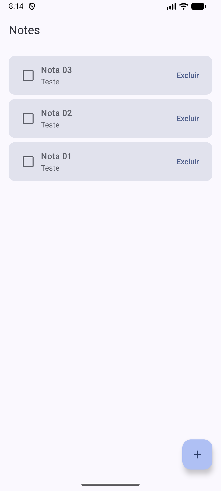
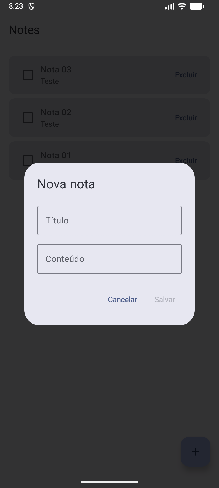
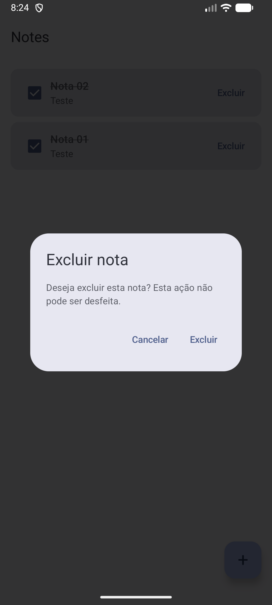

# Notes App

A native Android notes app built with Kotlin, Jetpack Compose and Room. Create, list, edit and delete notes, with all data persisted locally on the device.

Developed as the final project of the Mobile App Development course (Systems Analysis and Development).

## Screenshots

| Notes list | Create / edit | Delete confirmation |
| --- | --- | --- |
|  |  |  |

## Features

- Create notes with a title and content
- List all notes, newest first, with an empty state
- Edit a note by tapping on it
- Mark notes as done or pending (done notes are struck through)
- Delete notes with a confirmation dialog to avoid accidental loss
- Validation against empty notes
- Data persisted locally with Room (SQLite), kept after closing and reopening the app

## Tech stack

- Kotlin
- Jetpack Compose with Material 3
- Room (SQLite) with KSP
- ViewModel, StateFlow and Kotlin Coroutines / Flow
- Gradle Kotlin DSL with a version catalog

## Architecture

The app follows an MVVM-style structure:

- `data`: the `Note` entity, the `NoteDao` and the `AppDatabase` (Room)
- `ui/notes`: `NotesScreen` (Compose UI) and `NotesViewModel`
- `ui/theme`: Material 3 theme

The screen observes the list of notes exposed by the ViewModel as a `StateFlow`, and the ViewModel talks to the DAO. Because the DAO returns a `Flow`, the UI updates automatically whenever the database changes.

## Getting started

1. Clone this repository: `git clone https://github.com/RyanMoraess/notes-app.git`
2. Open it in Android Studio
3. Run the app on an emulator or a physical device (minimum SDK 24)

## Next steps

- Separate screens with Navigation Compose
- Keep the dialog state in the ViewModel to survive screen rotation
- Unit and instrumented tests for the DAO and the ViewModel
- Search and filter notes

## License

This project is licensed under the MIT License.